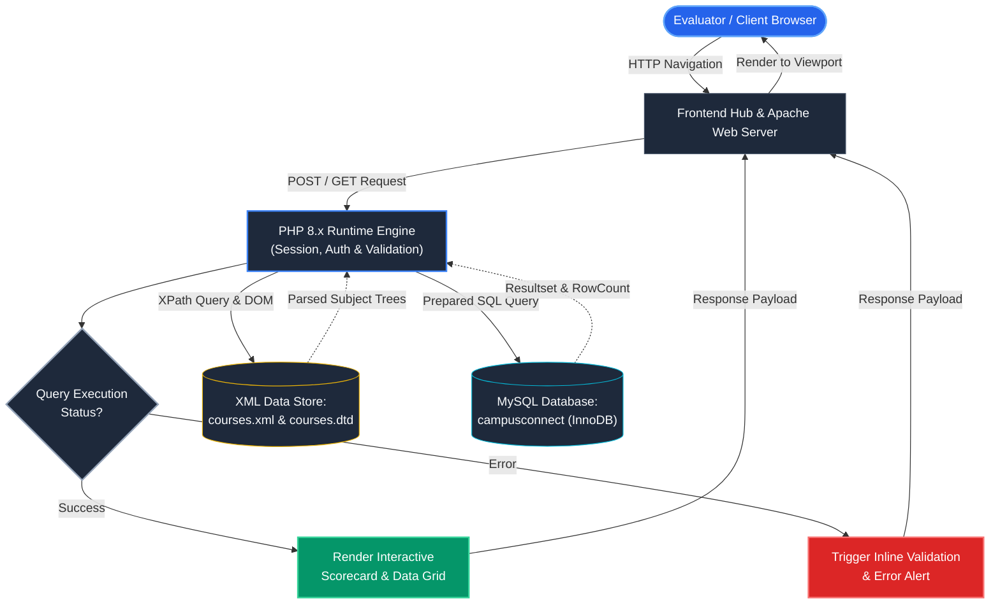
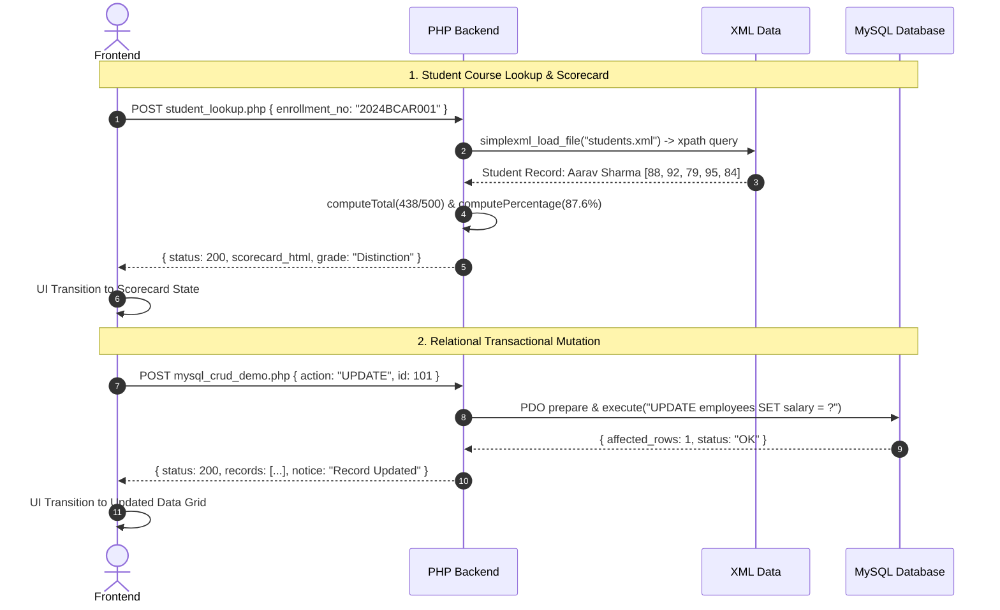

# CampusConnect — Smart Campus Management System

[](https://www.php.net/)
[](https://www.mysql.com/)
[](https://getbootstrap.com/)
[](#architecture)
[](#)

A centralized full-stack academic and campus management web application engineered for college students and academic administrators. Built using **PHP 8 (PDO)**, **MySQL / MariaDB**, **Vanilla JavaScript**, **Bootstrap 5**, **AJAX (Fetch API)**, **JSON APIs**, and **XML / DTD**.

Developed as an **Advanced Web Technologies (AWT) Final Capstone Project** with complete academic syllabus coverage.

---

## Table of Contents

1. [Project Overview & Problem Statement](#project-overview--problem-statement)
2. [Key Features](#key-features)
   - [Public Portal](#public-portal)
   - [Student Portal](#student-portal)
   - [Administrator Console](#administrator-console)
3. [Technology Stack](#technology-stack)
4. [System Architecture & Folder Structure](#system-architecture--folder-structure)
5. [Database Architecture & Schema Summary](#database-architecture--schema-summary)
6. [XAMPP Local Installation & Setup Guide](#xampp-local-installation--setup-guide)
7. [Default Demonstration Accounts](#default-demonstration-accounts)
8. [CLI Administrator Provisioning Tool](#cli-administrator-provisioning-tool)
9. [Web Development Syllabus Coverage Checklist](#web-development-syllabus-coverage-checklist)
10. [Application Security Safeguards](#application-security-safeguards)
11. [Testing & Quality Assurance Results](#testing--quality-assurance-results)
12. [Known Limitations & Future Roadmap](#known-limitations--future-roadmap)

---

## Project Overview & Problem Statement

### The Problem
In modern university and collegiate environments, critical student resources are frequently fragmented across disparate platforms: lecture slides reside on disparate cloud drives, examination circulars sit on physical notice boards, assignment submissions rely on email attachments, and symposium registrations use external forms. This fragmentation leads to missed deadlines, administrative overhead, and communication lapses.

### The Solution: CampusConnect
CampusConnect unifies campus operations into a secure, intuitive, and responsive single-application environment:
- **For Students:** Instant access to course notes, assignment deadlines, submission portals, symposium registration, grievance feedback, and curriculum catalogues.
- **For Administrators & Faculty:** Central control panel for managing circulars, evaluating student submissions, tracking event capacity, auditing user records, and moderating institutional queries.

---

## Key Features

### Public Portal
- **Natural, Human-Crafted UI:** Minimalist Bootstrap 5 styling with muted blue accents, clean typography, and zero overdesigned gimmicks.
- **Dynamic Notice Board:** Real-time announcements retrieved directly from MySQL.
- **Upcoming Symposiums Calendar:** Featured academic and technical events.
- **Curriculum Catalogue (XML/DTD):** Interactive browser parsing an XML course syllabus validated against a Document Type Definition (`courses.dtd`).
- **Tri-State Theme Switcher:** Smooth toggling between **Light Mode**, **Dark Mode** (charcoal/slate theme), and **System Auto Mode** (following OS `prefers-color-scheme`) with `localStorage` persistence and zero theme flashing (FOUC).

### Student Portal
- **Personalized Student Dashboard:** Responsive multi-column layout with academic metrics, assignment deadlines, quick action shortcuts, study files library, and integrated notice board circulars.
- **Study Resource Library:** Asynchronous live search (AJAX Fetch API) with subject filtering and authenticated document downloads.
- **Assignment Submissions:** Detailed problem briefs, due date countdowns, status badges (Pending, Submitted, Graded), file upload support (PDF, DOCX, ZIP), and teacher score/feedback reviews.
- **Campus Event Booking:** One-click symposium registration with duplicate prevention constraints and real-time seat availability.
- **Student Grievance / Feedback:** Submission form with live character counter, category tags, and tracking of administrative responses.
- **Profile Management:** Update personal contact details and change password with current password verification.

### Administrator Console
- **Institutional Analytics:** Real-time metrics on enrolled students, uploaded materials, pending inquiries, and active assignments.
- **User Roster:** Search and filter users by role (Student, Admin), provision new accounts, and delete inactive records.
- **Study Resource Management (CRUD):** Upload syllabus notes with MIME/extension allowlists, edit metadata, and securely delete files from disk.
- **Assignment Creator & Submissions Grading:** Publish assignments with deadlines, view all submitted student solutions, download files, and assign marks and remarks.
- **Event Scheduling & Attendee Rosters:** Schedule symposiums with venue and seat capacity limits, view printable participant lists.
- **Notice Board Publisher (CRUD):** Publish, update, and pin urgent notices to the top of boards.
- **Feedback & Grievance Resolution:** Review student queries, update status (New, Reviewed, Resolved), and send official responses.

---

## Technology Stack

| Layer | Technologies Used | Rationale |
| :--- | :--- | :--- |
| **Frontend Framework** | Bootstrap 5.3.3, Bootstrap Icons 1.11.3 | Clean, industry-standard responsive component library. |
| **Styling & Theme** | CSS3 Custom Properties, Native Dark Mode | Zero-dependency styling with FOUC prevention and reduced motion support. |
| **Client Scripting** | Vanilla JavaScript (ES6+), jQuery 3.7.1 | Real-time validation, AJAX live search, theme storage, and syllabus animation demo. |
| **Backend Engine** | PHP 8.0+ | Server-side validation, secure sessions, role-based access control, file streaming. |
| **Data Layer** | PHP Data Objects (PDO) | 100% prepared SQL statements to eradicate SQL Injection vulnerabilities. |
| **Relational Database**| MySQL / MariaDB (InnoDB) | Foreign keys (`ON DELETE CASCADE`), unique constraints, composite indexes. |
| **Data Interchange** | XML, DTD, JSON | Dynamic syllabus validation with `DOMDocument`, RESTful search endpoints. |
| **Dev Environment** | XAMPP (Apache, MySQL, phpMyAdmin) | Standard local collegiate deployment stack. |

---

## System Architecture & Execution Flow

The CampusConnect portfolio architecture is engineered for dual-mode execution: instantaneous static asset delivery via optimized Apache web servers, and modular server-side processing powered by PHP 8.x PDO, XML DOM/DTD parsing, and MySQL relational backends.

### High-Level Flow



### Component & Execution Flow



### Folder Structure

```
Final-AWT-Project/
├── index.php                      # Public landing page with live database statistics
├── about.php                      # Project documentation, architecture & jQuery demo
├── courses.php                    # XML Course Catalogue parser & DTD validator
├── login.php                      # User authentication gateway (email & password)
├── register.php                   # Student self-registration form
├── logout.php                     # Session destruction and termination
├── download.php                   # Authorized, path-traversal protected file gateway
│
├── config/
│   ├── database.php               # PDO database connection manager (MySQL + fallback)
│   └── local.php                  # Optional local database overrides (git-ignored)
│
├── includes/
│   ├── functions.php              # Utility functions (url(), e(), time_ago(), flash messages)
│   ├── auth.php                   # Session verification, role guards (require_role)
│   ├── csrf.php                   # Cryptographic CSRF token generation and validation
│   ├── header.php                 # Semantic HTML5 header, navbar & theme switcher
│   ├── footer.php                 # Semantic HTML5 footer and asset loading
│   ├── student_sidebar.php        # Navigation menu for Student Portal
│   └── admin_sidebar.php          # Navigation menu for Administrator Portal
│
├── student/
│   ├── dashboard.php              # Student overview, statistics & deadlines
│   ├── resources.php              # Study material library with live AJAX search
│   ├── assignments.php            # Assignments listing, file submissions & grades
│   ├── events.php                 # Campus events calendar & registration
│   ├── feedback.php               # Grievance submission with character counter
│   └── profile.php                # Profile editing & password change
│
├── admin/
│   ├── dashboard.php              # Administrator overview & system statistics
│   ├── users.php                  # User and student management (CRUD)
│   ├── announcements.php          # Campus circulars publisher (CRUD)
│   ├── resources.php              # Study material upload and management (CRUD)
│   ├── assignments.php            # Assignment creator & student submissions grading
│   ├── events.php                 # Campus events scheduler & participant rosters
│   └── feedback.php               # Student inquiries moderation and response
│
├── api/
│   ├── search.php                 # JSON API endpoint for live resource search
│   └── announcements.php          # JSON API endpoint for latest circulars
│
├── actions/
│   ├── register_event.php         # Standalone action endpoint for event sign-ups
│   └── submit_feedback.php        # Standalone action endpoint for grievance submissions
│
├── assets/
│   ├── css/
│   │   └── style.css              # Custom stylesheet, design tokens, light/dark themes
│   └── js/
│       ├── app.js                 # Theme switcher, password visibility, modals
│       ├── validation.js          # Client-side form validation
│       └── search.js              # AJAX live search handler with debouncing
│
├── uploads/
│   ├── resources/                 # Storage for uploaded lecture notes and slides
│   └── submissions/               # Storage for uploaded student assignment files
│
├── xml/
│   ├── courses.xml                # Well-formed XML course catalogue
│   └── courses.dtd                # Document Type Definition (DTD) validation schema
│
├── database/
│   └── campusconnect.sql          # Complete importable MySQL schema and seed data
│
├── scripts/
│   ├── create_admin.php           # CLI administrator provisioning script
│   └── init_test_db.php           # Offline test database initializer
│
├── tests/
│   └── test_suite.php             # Automated QA test suite
│
├── .gitignore                     # Git exclusion rules
└── README.md                      # Comprehensive project documentation
```

---

## Database Architecture & Schema Summary

The database is named `campusconnect` and incorporates relational integrity with foreign keys, unique constraints, and indexes.

### Relational Schema Summary:

1. **`users`**
   - `id` (INT, PK, AUTO_INCREMENT)
   - `name` (VARCHAR 100), `email` (VARCHAR 150, UNIQUE), `password_hash` (VARCHAR 255)
   - `role` (ENUM: `student`, `admin`), `department`, `roll_number`, `phone`
   - `created_at`, `updated_at` (TIMESTAMP)

2. **`announcements`**
   - `id` (INT, PK, AUTO_INCREMENT)
   - `title` (VARCHAR 200), `content` (TEXT), `category` (VARCHAR 50), `is_pinned` (TINYINT 1)
   - `created_by` (INT, FK -> `users.id` ON DELETE CASCADE)
   - `created_at`, `updated_at` (TIMESTAMP)

3. **`resources`**
   - `id` (INT, PK, AUTO_INCREMENT)
   - `title` (VARCHAR 200), `subject` (VARCHAR 100), `description` (TEXT)
   - `file_path` (VARCHAR 255), `file_name` (VARCHAR 255), `file_size` (INT), `file_type` (VARCHAR 100)
   - `uploaded_by` (INT, FK -> `users.id` ON DELETE CASCADE), `created_at` (TIMESTAMP)

4. **`assignments`**
   - `id` (INT, PK, AUTO_INCREMENT)
   - `title` (VARCHAR 200), `subject` (VARCHAR 100), `description` (TEXT), `due_date` (DATETIME), `max_marks` (INT)
   - `created_by` (INT, FK -> `users.id` ON DELETE CASCADE), `created_at` (TIMESTAMP)

5. **`assignment_submissions`**
   - `id` (INT, PK, AUTO_INCREMENT)
   - `assignment_id` (INT, FK -> `assignments.id` ON DELETE CASCADE)
   - `student_id` (INT, FK -> `users.id` ON DELETE CASCADE)
   - `file_path` (VARCHAR 255), `file_name` (VARCHAR 255), `submission_notes` (TEXT)
   - `status` (ENUM: `pending`, `submitted`, `graded`), `grade` (VARCHAR 10), `feedback` (TEXT)
   - `submitted_at`, `updated_at` (TIMESTAMP)
   - **Constraint:** `UNIQUE KEY (assignment_id, student_id)`

6. **`events`**
   - `id` (INT, PK, AUTO_INCREMENT)
   - `title` (VARCHAR 200), `description` (TEXT), `event_date` (DATETIME), `venue` (VARCHAR 150), `capacity` (INT), `category` (VARCHAR 50)
   - `created_by` (INT, FK -> `users.id` ON DELETE CASCADE), `created_at` (TIMESTAMP)

7. **`event_registrations`**
   - `id` (INT, PK, AUTO_INCREMENT)
   - `event_id` (INT, FK -> `events.id` ON DELETE CASCADE)
   - `student_id` (INT, FK -> `users.id` ON DELETE CASCADE)
   - `registered_at` (TIMESTAMP)
   - **Constraint:** `UNIQUE KEY (event_id, student_id)`

8. **`feedback`**
   - `id` (INT, PK, AUTO_INCREMENT)
   - `student_id` (INT, FK -> `users.id` ON DELETE CASCADE)
   - `subject` (VARCHAR 150), `category` (VARCHAR 50), `message` (TEXT)
   - `status` (ENUM: `new`, `reviewed`, `resolved`), `admin_response` (TEXT)
   - `created_at`, `updated_at` (TIMESTAMP)

---

## XAMPP Local Installation & Setup Guide

Follow these steps to run CampusConnect locally using XAMPP:

### Step 1: Clone or Copy to XAMPP `htdocs`
Place the project directory inside your XAMPP web root:
- **macOS:** `/Applications/XAMPP/xamppfiles/htdocs/campusconnect/`
- **Windows:** `C:\xampp\htdocs\campusconnect\`
- **Linux:** `/opt/lampp/htdocs/campusconnect/`

### Step 2: Start Apache and MySQL Services
1. Open the **XAMPP Control Panel**.
2. Click **Start** for both **Apache** and **MySQL**.
3. Verify that both modules display a green status indicator.

### Step 3: Import the Database Schema
1. Open your web browser and navigate to **phpMyAdmin**:
   ```
   http://localhost/phpmyadmin/
   ```
2. Click the **Import** tab on the top navigation bar.
3. Click **Choose File** and select:
   ```
   campusconnect/database/campusconnect.sql
   ```
4. Click **Import** (or **Go**).
5. Verify that the `campusconnect` database is created with all 8 tables and demonstration records.

### Step 4: Configure Database Credentials (If Needed)
CampusConnect is configured to connect to standard XAMPP defaults out-of-the-box (`host: 127.0.0.1`, `user: root`, `password: ''`, `database: campusconnect`).

If your local MySQL uses a custom password or port, create a file named `config/local.php`:
```php
<?php
define('DB_HOST', '127.0.0.1');
define('DB_PORT', '3306');
define('DB_NAME', 'campusconnect');
define('DB_USER', 'root');
define('DB_PASS', 'your_password_here');
```

### Step 5: Launch the Application
Open your web browser and navigate to:
```
http://localhost/campusconnect/
```
*(The automatic base URL detection helper `url()` ensures all navigation links, CSS stylesheets, images, and API requests resolve accurately regardless of whether the folder is named `campusconnect` or `Final-AWT-Project`).*

---

## Default Demonstration Accounts

Pre-seeded accounts are provided for testing and evaluation viva demonstrations:

| Role | Email Address | Password | Details |
| :--- | :--- | :--- | :--- |
| **Administrator** | `admin@campusconnect.edu` | `AdminPassword123!` | System Administrator (Full access) |
| **Student** | `aarav.sharma@campusconnect.edu` | `StudentPass123!` | BCA Semester 5 &bull; Roll: `CC-2023-BCA-001` |
| **Student** | `priya.patel@campusconnect.edu` | `StudentPass123!` | BCA Semester 5 &bull; Roll: `CC-2023-BCA-002` |
| **Student** | `rohan.verma@campusconnect.edu` | `StudentPass123!` | B.Sc IT Semester 3 &bull; Roll: `CC-2024-IT-015` |

*(Passphrases are hashed with Bcrypt via `password_hash()`).*

---

## CLI Administrator Provisioning Tool

To create a brand-new administrator account securely via terminal:

```bash
# Interactive mode:
php scripts/create_admin.php

# Direct arguments:
php scripts/create_admin.php "Prof. Vikram Malhotra" "v.malhotra@campusconnect.edu" "SecureAdmin2026!"
```

---

## Web Development Syllabus Coverage Checklist

| Syllabus Topic | Concept Demonstrated | File Reference |
| :--- | :--- | :--- |
| **HTML5 Semantic Elements** | `<header>`, `<nav>`, `<main>`, `<section>`, `<aside>`, `<footer>`, `<figure>` | `includes/header.php`, `includes/footer.php`, `index.php` |
| **Forms & Input Elements** | Text, email, password, file, select, textarea, checkbox, `datetime-local` | `register.php`, `student/assignments.php`, `admin/resources.php` |
| **Tables & Data Display** | Responsive Bootstrap data tables with captions and striped rows | `admin/users.php`, `student/dashboard.php` |
| **Legacy HTML Tag Sandbox** | Educational demo of syllabus `<marquee>` tag in an isolated container | `about.php` |
| **CSS3 Custom Properties** | Theme variables for body bg, card bg, borders, text color, primary accents | `assets/css/style.css` |
| **Dark / Light / System Mode** | Native `data-bs-theme`, OS `prefers-color-scheme`, `localStorage` persistence | `assets/js/app.js`, `includes/header.php` |
| **Bootstrap 5 Components** | Navbar, cards, modals, badges, dropdowns, alerts, responsive grid | Throughout all public and portal views |
| **JavaScript & DOM** | Event listeners (`click`, `input`, `change`, `blur`), password view toggle | `assets/js/app.js`, `assets/js/validation.js` |
| **Form Validation** | Real-time client-side checks and server-side validation with feedback | `assets/js/validation.js`, `register.php` |
| **AJAX (Fetch API)** | Asynchronous live study material search with debouncing | `assets/js/search.js`, `student/resources.php` |
| **JSON API** | RESTful JSON endpoints returning status, counts, and formatted arrays | `api/search.php`, `api/announcements.php` |
| **jQuery Demonstration** | `$(document).ready()`, element selector, `.slideToggle()` module notes animation | `about.php` |
| **XML & DTD** | Well-formed course catalogue with Document Type Definition schema | `xml/courses.xml`, `xml/courses.dtd` |
| **PHP XML Parsing** | Safe `DOMDocument` validation (`->validate()`) and `SimpleXMLElement` rendering | `courses.php` |
| **PHP Sessions & Auth** | `session_regenerate_id(true)`, role authorization guards (`require_role`) | `includes/auth.php` |
| **Security & Hashing** | Bcrypt `password_hash()` and `password_verify()` | `register.php`, `login.php`, `scripts/create_admin.php` |
| **CSRF Defense** | Cryptographic session token generation and verification on POST requests | `includes/csrf.php` |
| **XSS Mitigation** | Contextual HTML sanitization helper function `e()` | `includes/functions.php` |
| **Relational MySQL & PDO** | Parameterized queries, foreign keys (`ON DELETE CASCADE`), unique keys | `database/campusconnect.sql`, `config/database.php` |

---

## Application Security Safeguards

1. **SQL Injection Defense:** All queries utilize PDO prepared statements with parameter binding. User input is never concatenated into raw SQL.
2. **Password Hashing:** Passwords are hashed using the Bcrypt algorithm via `password_hash($pass, PASSWORD_BCRYPT)`.
3. **Cross-Site Scripting (XSS):** All dynamic database content is escaped through the `e()` helper function (`htmlspecialchars(..., ENT_QUOTES | ENT_SUBSTITUTE, 'UTF-8')`).
4. **Cross-Site Request Forgery (CSRF):** Every state-changing form includes a cryptographically secure token (`csrf_field()`) validated on the server via `validate_csrf()`.
5. **Session Fixation Prevention:** Session IDs are regenerated upon successful authentication via `session_regenerate_id(true)`.
6. **Role-Based Access Control:** Role checks (`require_role('admin')` / `require_role('student')`) run on the server before rendering protected views.
7. **Directory Traversal Protection:** File downloads in `download.php` verify the canonical path via `realpath()` and confirm it resides strictly inside the `uploads/` directory.
8. **Upload Restrictions:** File uploads enforce strict file-size limits (10MB–15MB) and allowlists for extensions (`pdf`, `docx`, `pptx`, `txt`, `zip`).

---

## Testing & Quality Assurance Results

The project was validated using both automated test suites and interactive browser walkthroughs:

```
========================================================
   CampusConnect Automated Test & Verification Suite    
========================================================

 [PASS] Database PDO Connection
 [PASS] All 8 Required Database Tables Exist
 [PASS] Admin Seed Account & Bcrypt Password
 [PASS] Student Seed Account & Bcrypt Password
 [PASS] Duplicate Event Registration Prevention (Unique Constraint)
 [PASS] CSRF Token Cryptographic Validation
 [PASS] XSS Sanitization Helper e()
 [PASS] XML Course Catalogue & DTD Schema Validation
 [PASS] Study Resource Query Search Execution

========================================================
 Test Suite Finished: 9 Passed, 0 Failed
========================================================
```

- **PHP Syntax:** All 34 `.php` files passed `php -l` linting with 0 syntax errors.
- **DTD Schema:** `xml/courses.xml` passed validation against `xml/courses.dtd` via `DOMDocument::validate()`.
- **Browser Automation:** Tested and verified light/dark/system theme switching, student login, live AJAX search, assignment submission, event registration, and administrator dashboards.

To re-run the automated verification suite at any time:
```bash
php tests/test_suite.php
```

---

## Known Limitations & Future Roadmap

### Current Scope & Deliberate Choices
- **Authentication Model:** CampusConnect utilizes session-based authentication designed for local collegiate demonstration. Single Sign-On (SSO) via SAML or LDAP is not implemented.
- **File Storage:** Uploaded lecture materials and assignments are stored on the local filesystem (`uploads/`) with database path tracking, suitable for standard XAMPP environments rather than cloud object storage (e.g., AWS S3).
- **Public Admin Registration:** As mandated by security best practices, public administrator registration is disabled; administrators can only be created via the CLI script (`scripts/create_admin.php`) or by an existing admin.

### Future Roadmap
- Integration with campus email gateways (PHPMailer / SMTP) for automated deadline reminder alerts.
- PDF generation for attendance and event ticket badges using TCPDF or FPDF.
- Real-time student-to-instructor messaging using WebSockets.

---

**CampusConnect** — Developed for Academic Demonstration & Portfolio Showcase.
